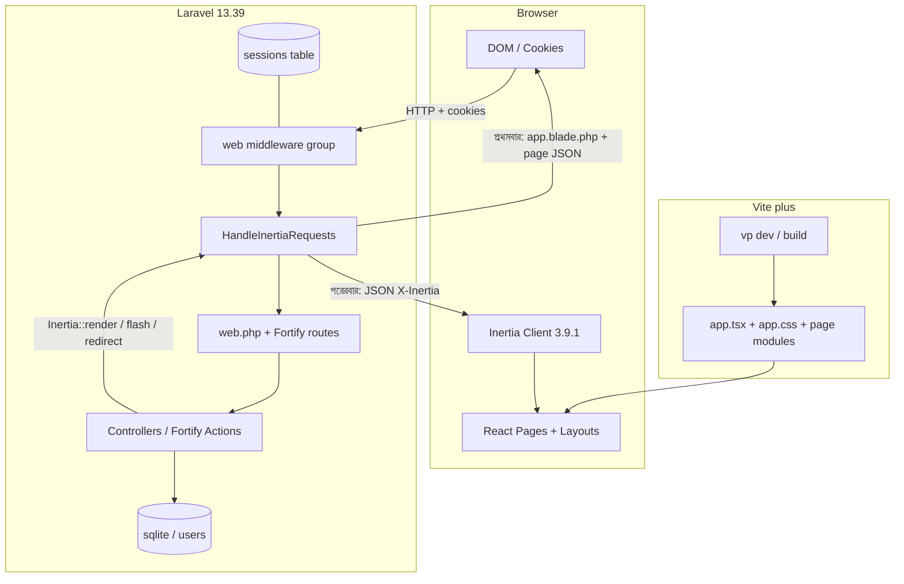
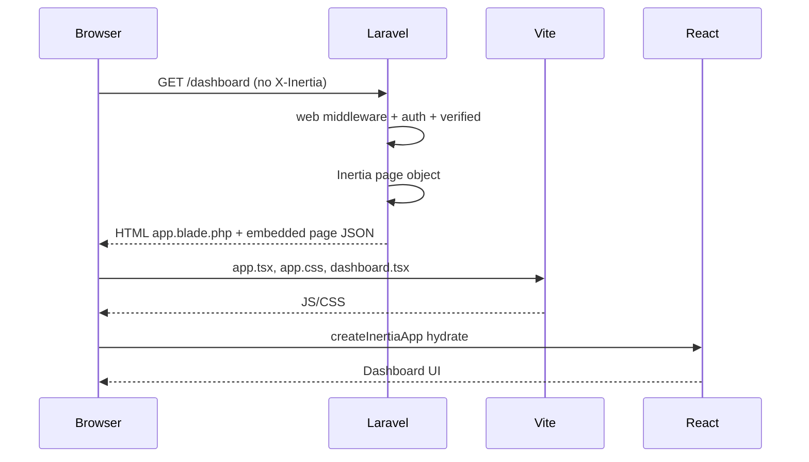
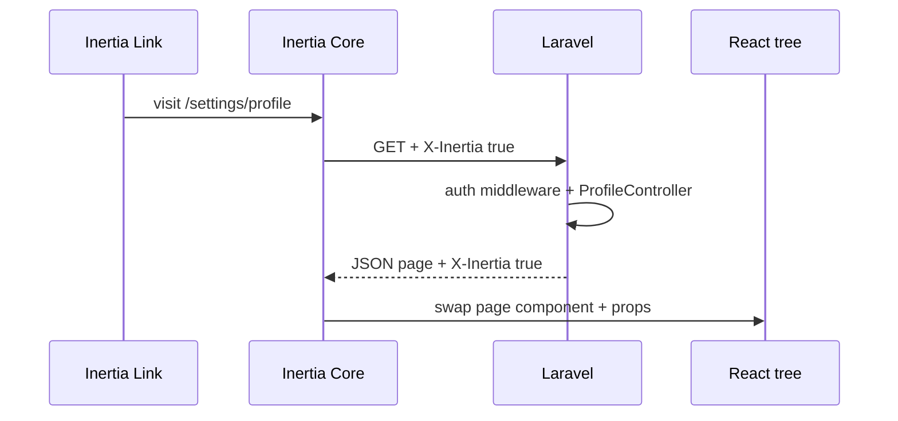
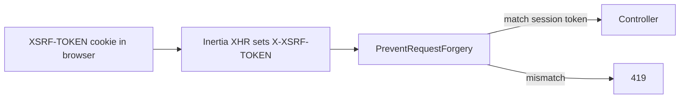
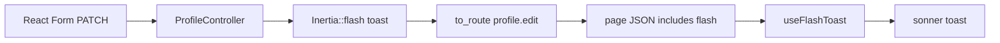
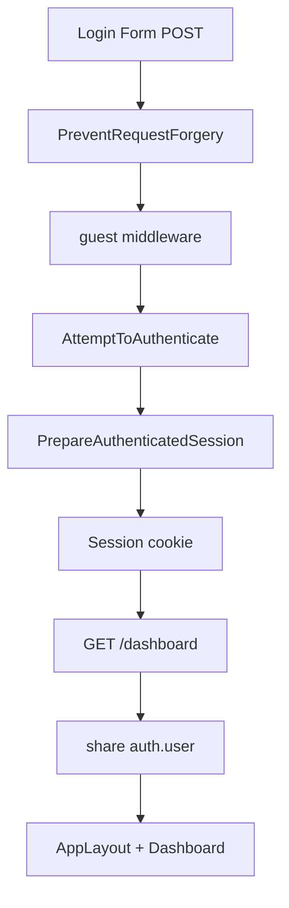

# Laravel 13 + Inertia.js + React.js — সম্পূর্ণ বাংলা টিউটোরিয়াল

এই ডকুমেন্টটি **আপনার বিদ্যমান প্রজেক্ট** (`laravel/react-starter-kit`) পরিদর্শন করে লেখা। কোনো ফাইল অনুমান করা হয়নি। অ্যাপ্লিকেশন কোড পরিবর্তন করা হয়নি। CRUD উদাহরণগুলো শেখার জন্য; চাইলে পরে আলাদাভাবে যোগ করতে পারেন।

**লক ফাইল থেকে ইনস্টল করা ভার্সন**

| প্যাকেজ | ভার্সন |
|---|---|
| `laravel/framework` | v13.39.0 |
| `inertiajs/inertia-laravel` | v3.5.2 |
| `@inertiajs/react` / `@inertiajs/core` / `@inertiajs/vite` | 3.9.1 |
| `react` / `react-dom` | 19.3.1 |
| `laravel/fortify` | v1.41.0 |
| `laravel/wayfinder` | ^0.1.14 |
| `laravel-vite-plugin` | 3.2.0 |
| PHP | ^8.3 |
| Vite | `vite-plus` 1.4.0 (`vp`) |

---

## 1. আপনার বিদ্যমান প্রজেক্ট আর্কিটেকচার

### 1.1 এটি কী ধরনের প্রজেক্ট

এটি Traditional Blade SPA নয়, REST API + আলাদা React অ্যাপও নয়। এটি **monolith**: একই Laravel অ্যাপ সার্ভার-সাইড রাউটিং, সেশন, CSRF, অথেন্টিকেশন চালায়; ব্রাউজারে React পেজ রেন্ডার করে **Inertia.js**।

স্টার্টার কিটের নাম `composer.json`-এ: `laravel/react-starter-kit`।

### 1.2 যে ফাইলগুলো নেই — এবং কেন

| খোঁজা ফাইল | অবস্থা | ব্যাখ্যা |
|---|---|---|
| `app/Http/Kernel.php` | নেই | Laravel 11+ / 13-এ HTTP kernel `bootstrap/app.php`-এ কনফিগার হয়। |
| `routes/api.php` | নেই / রেজিস্টার হয়নি | `bootstrap/app.php`-এ শুধু `web` ও `console` রাউট লোড হয়। পেজের জন্য আলাদা REST API লাগে না। |
| `config/csrf.php` | নেই | CSRF `web` মিডলওয়্যার গ্রুপের `PreventRequestForgery` দিয়ে চলে। |
| `resources/js/app.jsx` | নেই | এন্ট্রি পয়েন্ট `resources/js/app.tsx` (TypeScript + React)। |
| `resources/js/Pages/` | নেই | পেজগুলো ছোট হাতের `resources/js/pages/`-এ। |
| `resources/js/ssr.tsx` | নেই | `config/inertia.php`-এ `ssr.enabled => true`, কিন্তু প্রজেক্টে SSR এন্ট্রি ফাইল নেই। প্র্যাকটিক্যালি প্রাথমিক লোড ক্লায়েন্ট-সাইড React hydrate করে। |

### 1.3 মূল ফোল্ডার মানচিত্র

```
sumonreact/
├── bootstrap/app.php              # অ্যাপ বুট, রাউটিং, মিডলওয়্যার
├── bootstrap/providers.php        # AppServiceProvider, FortifyServiceProvider
├── routes/web.php                 # হোম + ড্যাশবোর্ড
├── routes/settings.php            # প্রোফাইল, সিকিউরিটি, appearance
├── app/Http/Middleware/
│   ├── HandleInertiaRequests.php  # Inertia shared props + root view
│   └── HandleAppearance.php       # appearance কুকি → Blade
├── app/Http/Controllers/Settings/ # ProfileController, SecurityController
├── app/Providers/FortifyServiceProvider.php  # login/register Inertia views
├── resources/views/app.blade.php  # একমাত্র root HTML শেল
├── resources/js/app.tsx           # createInertiaApp
├── resources/js/pages/            # Inertia পেজ কম্পোনেন্ট
├── resources/js/layouts/
├── resources/js/components/
├── resources/js/routes/           # Wayfinder-জেনারেটেড URL
├── resources/js/actions/          # Wayfinder controller helpers
├── vite.config.ts
└── config/inertia.php, session.php, auth.php, fortify.php
```

### 1.4 দায়িত্ব ভাগ

| স্তর | কী করে | কী করে না |
|---|---|---|
| **Browser** | কুকি পাঠায়, JS চালায়, DOM দেখায় | ডাটাবেস ছুঁয় না |
| **Vite / vite-plus** | JS/CSS বান্ডল, dev HMR | রাউট বা অথ করে না |
| **React** | UI, ফর্ম স্টেট, পেজ কম্পোনেন্ট | সরাসরি Laravel সেশন/DB ছুঁয় না |
| **Inertia client** | XHR ভিজিট, হেডার, পেজ সোয়াপ, CSRF হেডার | সার্ভার অথ ঠিক করে না |
| **Laravel** | রাউট, মিডলওয়্যার, ভ্যালিডেশন, DB, সেশন | ব্রাউজারে কম্পোনেন্ট মাউন্ট করে না |
| **Inertia Laravel adapter** | HTML বা JSON পেজ পে-লোড তৈরি, shared props, flash | React রেন্ডার করে না |
| **Database** | users, sessions, jobs, cache | UI জানে না |

---

## 2. Inertia.js কী এবং কেন ব্যবহার হয়

Inertia একটি **প্রোটোকল + অ্যাডাপ্টার**, ফুল ফ্রন্টএন্ড রাউটার ফ্রেমওয়ার্ক নয়।

আপনি Blade-এ যেভাবে লিখতেন:

```php
return view('dashboard', ['user' => $user]);
```

Inertia-তে একই ধারণা:

```php
return Inertia::render('dashboard', ['user' => $user]);
```

পার্থক্য: Laravel HTML পেজের বদলে **একটি পেজ অবজেক্ট** পাঠায় (`component`, `props`, `url`, `version`)। ব্রাউজারের Inertia সেই নামের React কম্পোনেন্ট খুঁজে props দিয়ে রেন্ডার করে।

**কেন:** একই Laravel রাউট/মিডলওয়্যার/সেশন/CSRF রেখে React UI ব্যবহার করা যায়। আলাদা REST API, SPA auth (JWT/Sanctum token SPA), বা React Router-এর পুরো ক্লায়েন্ট রাউট টেবিল লাগে না।

আপনার প্রজেক্টে সার্ভার অ্যাডাপ্টার: `inertiajs/inertia-laravel` v3.5.2। ক্লায়েন্ট: `@inertiajs/react` 3.9.1। পেজ রেজল্যুশন Vite প্লাগইন `@inertiajs/vite` করে; তাই `app.tsx`-এ পুরনো `resolve: (name) => import(...)` নেই।

---

## 3. তিনটি আর্কিটেকচার তুলনা

| বিষয় | Laravel + Blade | Laravel API + React | **আপনার: Laravel + Inertia + React** |
|---|---|---|---|
| ব্রাউজার রিকোয়েস্ট | সাধারণ ডকুমেন্ট GET/POST | JSON API + আলাদা SPA | প্রথমবার HTML, পরে `X-Inertia: true` XHR |
| রাউটিং | `routes/web.php` | `routes/api.php` + React Router | **`routes/web.php`ই সোর্স অফ ট্রুথ** |
| কন্ট্রোলার | `view()` | `response()->json()` | `Inertia::render()` / `Route::inertia()` |
| ডাটা পাঠানো | Blade ভেরিয়েবল | JSON body | Inertia **props** |
| রেন্ডার | সার্ভারে HTML | ক্লায়েন্টে React | প্রথমবার HTML শেল + JSON page; পরে শুধু JSON page |
| নেভিগেশন | ফুল পেজ রিলোড | ক্লায়েন্ট রাউট | Inertia visit, DOM পুরো রিলোড হয় না |
| ফর্ম | `<form>` + `@csrf` | `fetch`/axios + token/cookie | `<Form>` / `router.post()` + `X-XSRF-TOKEN` |
| অথ | সেশন + Blade `@auth` | Token বা Sanctum SPA | **একই সেশন গার্ড `web`**, user shared prop |

**কখন কোনটা:** অ্যাডমিন প্যানেল, CRUD, সেশন-ভিত্তিক অ্যাপ → Inertia। পাবলিক মার্কেটিং সাইট/ইমেইল HTML → Blade। মোবাইল অ্যাপ বা তৃতীয় পক্ষের ক্লায়েন্ট → REST/JSON API।

---

## 4. সম্পূর্ণ অ্যাপ্লিকেশন আর্কিটেকচার



**Arrow অর্থ**

1. ব্রাউজার Laravel-এ HTTP পাঠায়; সেশন কুকি ও `XSRF-TOKEN` কুকি সাথে যায়।
2. Laravel মিডলওয়্যার সেশন খুলে, CSRF চেক করে, তারপর রাউট ম্যাচ করে।
3. কন্ট্রোলার DB পড়ে `Inertia::render('dashboard', $props)` ফেরায়।
4. Inertia adapter দেখে `X-Inertia` হেডার আছে কি না: না থাকলে HTML, থাকলে JSON।
5. Vite শুধু অ্যাসেট দেয়; ব্যবসায়িক ডাটা দেয় না।
6. React শুধু props দেখায়; Laravel-ই সত্যের উৎস।

---

## 5. Initial Page Load Lifecycle (`GET /dashboard` প্রথমবার)

ধরুন ইউজার লগইন করা, ব্রাউজার অ্যাড্রেসবারে `/dashboard` টাইপ করল। এটি **ডকুমেন্ট নেভিগেশন**, Inertia visit নয়।

### ধাপ 1 — ব্রাউজার HTTP রিকোয়েস্ট

```
GET /dashboard HTTP/1.1
Host: localhost:8000
Accept: text/html,application/xhtml+xml,...
Cookie: laravel-session=...; XSRF-TOKEN=...; appearance=system; sidebar_state=true
```

এখানে **`X-Inertia` নেই**। তাই Laravel এটাকে সাধারণ ওয়েব রিকোয়েস্ট মনে করে।

### ধাপ 2–3 — Laravel গ্রহণ ও মিডলওয়্যার

Laravel 13-এ `app/Http/Kernel.php` নেই। পাইপলাইন `bootstrap/app.php` + ফ্রেমওয়ার্কের ডিফল্ট `web` গ্রুপ।

**আপনার প্রজেক্টের `web` অর্ডার (Laravel 13.39 ডিফল্ট + append):**

1. `EncryptCookies` — `appearance`, `sidebar_state` encrypt হয় না (`bootstrap/app.php`)
2. `AddQueuedCookiesToResponse`
3. `StartSession` — `SESSION_DRIVER=database`, টেবিল `sessions`
4. `ShareErrorsFromSession`
5. `PreventRequestForgery` — Laravel 13-এ পুরনো নাম `ValidateCsrfToken` নয়; GET-এ সাধারণত CSRF চেক স্কিপ
6. `SubstituteBindings`
7. `HandleAppearance` — কুকি থেকে `$appearance` Blade-এ
8. `HandleInertiaRequests` — shared props সেট
9. `AddLinkHeadersForPreloadedAssets` — Vite preload Link হেডার

### ধাপ 4–6 — কুকি, সেশন, অথ

`StartSession` কুকি `laravel-session` (ডিফল্ট নাম: `Str::slug(APP_NAME).'-session'`) পড়ে `sessions` টেবিল থেকে পেলোড লোড করে। তারপর `auth` মিডলওয়্যার (`routes/web.php`) `Auth::check()` করে। না থাকলে `/login`-এ পাঠায়।

```php
Route::middleware(['auth', 'verified'])->group(function () {
    Route::inertia('dashboard', 'dashboard')->name('dashboard');
});
```

`verified` লাগে কারণ `User` implements `MustVerifyEmail`।

### ধাপ 7–9 — রাউট ও “কন্ট্রোলার”

`Route::inertia('dashboard', 'dashboard')` আলাদা কন্ট্রোলার ক্লাস ছাড়াই Inertia পেজ `dashboard` রেন্ডার করে — অর্থাৎ `resources/js/pages/dashboard.tsx`।

এটি Blade-এর `Route::view()`-এর Inertia সমতুল্য।

### ধাপ 10–11 — প্রথমবারের HTML রেসপন্স

`Inertia\Response::toResponse()` দেখে `X-Inertia` নেই, তাই `resources/views/app.blade.php` রেন্ডার করে। পেজ অবজেক্ট Blade-এ `$page` হিসেবে যায়; `<x-inertia::app />` সেই JSON এমবেড করে।

উদাহরণ পেজ পে-লোড (সার্ভার-সাইড শেষে তৈরি):

```json
{
  "component": "dashboard",
  "props": {
    "errors": {},
    "name": "Laravel",
    "auth": { "user": { "id": 1, "name": "Sumon", "email": "a@b.com", "email_verified_at": "..." } },
    "sidebarOpen": true
  },
  "url": "/dashboard",
  "version": null
}
```

Dev-এ Vite manifest না থাকলে `HandleInertiaRequests::version()` প্রায়ই `null`। Production-এ `public/build/manifest.json` হ্যাশ হয়।

**সার্ভার-সাইড এখানেই শেষ।** পরের কাজ ব্রাউজারে।

### ধাপ 12 — Vite অ্যাসেট

`app.blade.php`:

```blade
@viteReactRefresh
@vite(['resources/css/app.css', 'resources/js/app.tsx', "resources/js/pages/{$page['component']}.tsx"])
```

Dev: Vite dev সার্ভার (`npm run dev` / `vp dev`) থেকে মডিউল। Production: `vp build` এর হ্যাশড ফাইল।

তৃতীয় এন্ট্রি বর্তমান পেজ (`dashboard.tsx`) আগে থেকে লোড করে, যাতে hydration দ্রুত হয়।

### ধাপ 13–16 — React + Inertia

`resources/js/app.tsx` `createInertiaApp()` চালায়। `@inertiajs/vite` প্লাগইন পেজ মডিউল রিজলভ করে। `layout` ফাংশন `dashboard`-কে `AppLayout` দেয়। `Dashboard` কম্পোনেন্ট মাউন্ট হয়। `usePage().props.auth.user` সাইডবারে নাম দেখায়।



---

## 6. Subsequent Inertia Navigation (`/dashboard` → `/settings/profile`)

সাইডবার/ইউজার মেনুতে Settings `Link` (`user-menu-content.tsx`):

```tsx
<Link href={edit()} prefetch onClick={cleanup}>
```

`edit()` Wayfinder থেকে `/settings/profile`।

### Inertia `Link` কী করে

সাধারণ `<a href>` ব্রাউজারকে নতুন ডকুমেন্ট আনতে বলে — পুরো JS স্টেট মরে যায়। Inertia `Link` `click`-এ `preventDefault()` করে `router.visit()` চালায়।

Blade-এর `<a>` = ফুল রিলোড। React Router = ক্লায়েন্ট রাউট টেবিল, সার্ভার নাও লাগতে পারে। Inertia Link = **আবার Laravel রাউটই** হিট করে, কিন্তু ডকুমেন্ট রিলোড ছাড়া।

### যে HTTP রিকোয়েস্ট যায়

```
GET /settings/profile HTTP/1.1
X-Requested-With: XMLHttpRequest
X-Inertia: true
X-Inertia-Version: <asset version or empty>
Accept: text/html, application/xhtml+xml
Cookie: laravel-session=...; XSRF-TOKEN=...
```

`@inertiajs/core` 3.9.1 `X-Requested-With` এবং `X-Inertia: true` সেট করে (`node_modules/@inertiajs/core/dist/index.js`)।

| হেডার | কাজ |
|---|---|
| `X-Inertia` | Laravel adapter বোঝে JSON পেজ দিতে, HTML শেল নয় |
| `X-Inertia-Version` | অ্যাসেট ভার্সন মিলিয়ে পুরনো JS এড়াতে; না মিললে ফুল রিলোড |
| `X-Requested-With` | XHR হিসেবে চিহ্নিত; Laravel `ajax()` ইত্যাদিতে কাজে লাগে |

### Laravel কীভাবে চিনে

`Inertia\Response::toResponse()`:

```php
if ($request->header(Header::INERTIA)) {
    return new JsonResponse($page, 200, [Header::INERTIA => 'true']);
}
```

`ProfileController::edit()`:

```php
return Inertia::render('settings/profile', [
    'mustVerifyEmail' => $request->user() instanceof MustVerifyEmail,
    'status' => $request->session()->get('status'),
]);
```

রেসপন্স **JSON**, HTML নয়। স্ট্যাটাস 200, হেডার `X-Inertia: true`, `Vary: X-Inertia`।

বডি আনুমানিক:

```json
{
  "component": "settings/profile",
  "props": {
    "errors": {},
    "name": "Laravel",
    "auth": { "user": { "...": "..." } },
    "sidebarOpen": true,
    "mustVerifyEmail": true,
    "status": null
  },
  "url": "/settings/profile",
  "version": null
}
```

Inertia ক্লায়েন্ট কম্পোনেন্ট বদলায়, layout স্ট্যাক `[AppLayout, SettingsLayout]` লাগায়, `history.pushState` করে। `app.tsx` আবার চলে না, Vite আবার পুরো বান্ডল লোড করে না (পেজ মডিউল ডায়নামিক ইমপোর্ট হতে পারে)।

**অ্যাপ রিলোড হয় না কারণ** `<html>`/`<script>` আবার পার্স হয় না; শুধু React tree আপডেট হয়।



---

## 7. Laravel Routing

### যা একই থাকে (Blade জ্ঞান)

`routes/web.php` এখনও সোর্স অফ ট্রুথ। নেমড রাউট, মিডলওয়্যার, প্যারামিটার, `route()` সার্ভারে একই।

Inertia আলাদা রাউট ফাইল চালায় না। React Router টেবিল নেই।

### যা বদলেছে

Blade: `return view(...)`। এখানে: `Inertia::render` বা `Route::inertia`।

ফ্রন্টএন্ড URL হার্ডকোড না করে **Wayfinder** (`resources/js/routes/`, `resources/js/actions/`) Laravel রাউট থেকে TypeScript জেনারেট করে। `vite.config.ts`-এ `wayfinder({ formVariants: true })`।

উদাহরণ:

```tsx
import { dashboard } from '@/routes';
import { store } from '@/routes/login';
import ProfileController from '@/actions/App/Http/Controllers/Settings/ProfileController';

<Link href={dashboard()}>Dashboard</Link>
<Form {...store.form()}>...</Form>
<Form {...ProfileController.update.form()} method implied PATCH>
```

### ক্লায়েন্ট নেভিগেশন API (Inertia 3.9)

| API | ব্যবহার |
|---|---|
| `<Link href={...}>` | GET নেভিগেশন |
| `<Link href={logout()} as="button">` | POST (logout Wayfinder `method: 'post'`) |
| `router.visit(url, { method, data })` | জেনেরিক |
| `router.get/post/put/patch/delete` | শর্টকাট |
| `<Form {...route.form()}>` | আপনার অথেন্টিকেশন/প্রোফাইল ফর্ম |

কেন web রাউট, api রাউট নয়: প্রতিটি পেজের সাথে সেশন, CSRF, validation errors, redirects লাগে। JSON API বানালে সেগুলো নিজে নকল করতে হয়।

প্যারামিটার উদাহরণ (CRUD-এ ব্যবহার করবেন):

```php
Route::get('/products/{product}', [ProductController::class, 'show'])->name('products.show');
```

```tsx
import { show } from '@/routes/products';
<Link href={show(product.id)}>View</Link>
```

Laravel `{product}` → Eloquent binding; React শুধু URL-এ id পাঠায়। মডেল লোড সার্ভারে।

---

## 8. Middleware

### Blade vs Inertia

মিডলওয়্যার **একই পাইপলাইন**। পার্থক্য শেষের Inertia মিডলওয়্যার: shared data, version mismatch, 302→303 PUT/PATCH/DELETE-এ।

প্রথম ভিজিট ও পরের Inertia ভিজিট **দুটোতেই** পুরো `web` স্ট্যাক চলে। “Inertia সেশন স্কিপ করে” — ভুল।

### Inertia middleware কী শেয়ার করে

`HandleInertiaRequests::share()`:

```php
return [
    ...parent::share($request), // errors => Inertia::always(...)
    'name' => config('app.name'),
    'auth' => ['user' => $request->user()],
    'sidebarOpen' => ! $request->hasCookie('sidebar_state') || $request->cookie('sidebar_state') === 'true',
];
```

`parent::share` validation errors প্রতি রেসপন্সে বাধ্যতামূলক (`Inertia::always`)। তাই React `usePage().props.errors` বা `<Form>`-এর `errors` পায়।

`auth.user` প্রতি রিকোয়েস্টে সার্ভার থেকে আসে। React `localStorage`-এ ইউজার ধরে রাখা অথ নয়।

---

## 9. Requests and Responses

| পরিস্থিতি | স্ট্যাটাস | বডি |
|---|---|---|
| প্রথম পেজ | 200 | HTML (`app.blade.php`) |
| Inertia GET পেজ | 200 | JSON page, `X-Inertia: true` |
| ভ্যালিডেশন ফেল | 303 (Inertia) / redirect back | session errors → পরের পেজের `errors` prop |
| সফল POST | 302/303 redirect | পরের GET-এ নতুন পেজ |
| অগোছালো JSON API | 200 `{data:...}` | Inertia এভাবে পেজ চেনে না |
| বাইরের URL | `X-Inertia-Location` | ক্লায়েন্ট `window.location` |

Inertia JSON ≠ REST JSON। REST: আপনার রিসোর্স শেপ। Inertia: বাধ্যতামূলক `component` + `props` + `url` + `version`।

`Request` অবজেক্ট একই `Illuminate\Http\Request`। `$request->user()`, `$request->validated()` Blade প্রজেক্টের মতোই।

---

## 10. Controllers and Data Passing

Blade:

```php
return view('products.index', ['products' => $products]);
```

API:

```php
return response()->json(['products' => $products]);
```

Inertia (আপনার স্টাইল):

```php
return Inertia::render('products/index', [
    'products' => $products,
]);
```

React:

```tsx
export default function Index({ products }: { products: Product[] }) {
    return products.map((p) => <div key={p.id}>{p.name}</div>);
}
```

**Shared vs page props:** `auth`, `errors`, `name`, `sidebarOpen` সব পেজে। `mustVerifyEmail` শুধু profile পেজে।

**Inertia 3.5.2-এ আছে (মিক্স করবেন না পুরনো lazy API-এর সাথে):**

- `Inertia::optional(fn () => ...)` — চাইলে পাঠাবে
- `Inertia::defer(fn () => ...)` — পেজ আগে, ডাটা পরে partial request
- `Inertia::merge(...)` / `Inertia::scroll(...)` — infinite scroll
- `Inertia::always(...)` — partial reload-এও থাকবে (`errors` এভাবেই)
- `shareOnce` — নেভিগেশনে মনে রাখা

**Partial reload:** `router.reload({ only: ['products'] })` হেডার `X-Inertia-Partial-Data`, `X-Inertia-Partial-Component` পাঠায়। বড় লিস্টে বাদবাকি props বাঁচায়।

Eloquent মডেল JSON-এ `Hidden` অ্যাট্রিবিউট বাদে যায় (`password` ইত্যাদি `User` মডেলে hidden)। React DB দেখে না; শুধু JSON props পায়।

---

## 11. CSRF Protection (খুব জরুরি)

### CSRF কী

আরেক সাইটের ফর্ম আপনার লগইন করা ব্রাউজার দিয়ে `POST /logout` বা টাকা ট্রান্সফার চালানো। Laravel তাই POST/PUT/PATCH/DELETE-এ টোকেন চায়। GET নিরাপদ অপারেশনে সীমাবদ্ধ রাখুন।

### Blade ফর্মে

```blade
<form method="POST" action="/login">
    @csrf
</form>
```

হিডেন `_token`।

### আপনার Inertia অ্যাপে

`package.json`-এ **axios ডিপেন্ডেন্সি নেই**। Inertia core নিজে XHR ক্লায়েন্ট ব্যবহার করে:

- কুকি নাম: `XSRF-TOKEN` (HttpOnly **নয়**, যাতে JS পড়তে পারে)
- হেডার নাম: `X-XSRF-TOKEN`

Laravel 13 `PreventRequestForgery`:

1. `_token` ইনপুট, বা
2. `X-CSRF-TOKEN` হেডার, বা
3. `X-XSRF-TOKEN` হেডার → decrypt করে সেশনের `session()->token()`-এর সাথে `hash_equals`

আপনাকে লগইন ফর্মে `@csrf` লিখতে হয়নি। `<Form {...store.form()}>` Inertia দিয়ে POST `/login` করে; ক্লায়েন্ট কুকি থেকে হেডার লাগায়।

### তিনটি জিনিসের পার্থক্য

| নাম | কোথায় | HttpOnly | কাজ |
|---|---|---|---|
| **Session cookie** (`laravel-session`) | কুকি | সাধারণত true | সার্ভারে কোন সেশন রো |
| **CSRF token** | সেশন স্টোরেজের ভিতরের স্ট্রিং | সরাসরি কুকি নয় | সার্ভার যাচাই করে |
| **XSRF-TOKEN cookie** | কুকি, এনক্রিপ্টেড কপি | **false** | JS পড়ে `X-XSRF-TOKEN` হেডারে দেয় |

সেশন কুকি চুরি হলে সেশন হাইজ্যাক। CSRF টোকেন ছাড়া অন্য সাইট থেকে POST ব্লক। দুটো আলাদা সুরক্ষা।

### এক্সপায়ার/মিসম্যাচ

টোকেন না মিললে 419। Inertia সাধারণত এরর মডাল/রিলোড হ্যান্ডেল করে। লগআউটে `regenerateToken()` নতুন টোকেন দেয়।

### নিরাপদ ফর্ম (আপনার প্রোফাইল ফর্মই উদাহরণ)

`resources/js/pages/settings/profile.tsx` → `PATCH /settings/profile` → `ProfileUpdateRequest`। হেডার উদাহরণ:

```
PATCH /settings/profile
X-Inertia: true
X-XSRF-TOKEN: <decrypted-from-cookie-value-sent-as-header>
X-Requested-With: XMLHttpRequest
Cookie: laravel-session=...; XSRF-TOKEN=...
Content-Type: multipart/form-data or application/json
```



---

## 12. Sessions

ডিফল্ট: `SESSION_DRIVER=database`, লাইফটাইম 120 মিনিট, `.env.example` অনুযায়ী sqlite।

সেশন = সার্ভার-সাইড ব্যাগ। আইডি কুকিতে। ব্রাউজার রিফ্রেশ করলেও একই সেশন (মেয়াদ না কাটা পর্যন্ত)। Inertia নেভিগেশনেও একই কুকি যায়, তাই লগইন থাকে।

কন্ট্রোলারে:

```php
$request->session()->get('status');
$request->session()->invalidate();
$request->session()->regenerateToken();
```

React সরাসরি `session()` দেখে না। যা লাগে তা props বা `Inertia::flash` দিয়ে পাঠান।

লগইনের পর Fortify `PrepareAuthenticatedSession` সেশন regenerate করে fixation আটকায়।

---

## 13. Cookies

আপনার অ্যাপে দেখা যায়:

- সেশন কুকি — HttpOnly, SameSite=lax (`config/session.php`)
- `XSRF-TOKEN` — JS-readable
- `appearance` — encrypt বাদ, থিম
- `sidebar_state` — encrypt বাদ, সাইডবার

`Set-Cookie` উদাহরণ:

```
Set-Cookie: laravel-session=eyJpdiI6...; path=/; httponly; samesite=lax
Set-Cookie: XSRF-TOKEN=eyJpdiI6...; path=/; samesite=lax
```

`Secure` ফ্ল্যাগ `.env`-এর `SESSION_SECURE_COOKIE` / HTTPS-এ। লোকাল HTTP-তে প্রায়ই বন্ধ।

ব্রাউজার same-origin রিকোয়েস্টে কুকি অটো পাঠায়। Inertia আলাদা ডোমেইন API নয়, তাই `credentials` নিয়ে Sanctum SPA-এর মতো জটিলতা কম।

---

## 14. Flash Messages

পুরনো Blade: `session()->flash('success', 'Saved')` + `@if(session('success'))`।

আপনার প্রজেক্টে **Inertia v3 flash ইভেন্ট**:

```php
Inertia::flash('toast', ['type' => 'success', 'message' => __('Profile updated.')]);
return to_route('profile.edit');
```

Redirect-এ Inertia middleware flash সেশনে রাখে। পরের GET পেজ JSON-এ `flash` কী আসে। ক্লায়েন্ট `router.on('flash', ...)`।

`resources/js/hooks/use-flash-toast.ts` + `Toaster` (sonner) `app.tsx`-এর `withApp`।

টাইপ: `FlashToast` = `success | info | warning | error`।

ফ্লো:



একবার দেখানোর পর সেশন ফ্ল্যাশ খালি। তাই রিফ্রেশে আবার একই টোস্ট আসে না (নতুন রেসপন্সে flash না থাকলে)।

পুরনো শেয়ার করা `flash.success` prop এই স্টার্টার কিটে নেই; `status` স্ট্রিং কিছু Fortify পেজে আলাদাভাবে যায় (login, verify-email)।

---

## 15. Validation and Error Handling

Blade: redirect back + `$errors`। API: 422 JSON। Inertia: redirect back + `errors` **shared always prop**।

রেজিস্ট্রেশন: `CreateNewUser` `Validator::make(...)->validate()`। ফেল করলে Fortify ইউজার তৈরি করে না; Inertia ফর্মে `errors.name` ইত্যাদি।

`register.tsx`:

```tsx
<Form {...store.form()} resetOnSuccess={['password', 'password_confirmation']}>
    {({ processing, errors }) => (
        <InputError message={errors.email} />
    )}
</Form>
```

এখানে `useForm()` নেই; Inertia 3 **`<Form>`** render-prop। `processing` সাবমিট চলাকালীন।

প্রোফাইল: `ProfileUpdateRequest` + `ProfileValidationRules`।

404/500: Laravel exception renderer। `bootstrap/app.php` JSON শুধু `api/*` বা `expectsJson()`-এ। সাধারণ Inertia পেজ HTML এরর পেজ পেতে পারে; প্রোডাকশনে generic পেজ।

অথ এরর: `auth` মিডলওয়্যার গেস্টকে login-এ। `guest` মিডলওয়্যার লগইন ইউজারকে `/dashboard` (`fortify.home`)-এ।

---

## 16. Asset Bundling and Vite

Blade প্রজেক্ট: `@vite('resources/css/app.css')` + অল্প JS। এখানে React এন্ট্রি মূল অ্যাপ।

সম্পর্ক:

- Laravel HTML-এ `@vite` ট্যাগ বসায়
- `vite-plus` (`vp dev` / `vp build`) বান্ডল করে
- `laravel-vite-plugin` Laravel-Vite ব্রিজ, `refresh: true`
- `@vitejs/plugin-react` + React Compiler Babel preset
- `@inertiajs/vite` পেজ ডিসকভারি (`resources/js/pages`)
- `@tailwindcss/vite` CSS
- Wayfinder প্লাগইন রাউট টাইপ জেনারেট

`createInertiaApp` লেআউট ম্যাপ:

- `welcome` → লেআউট নেই
- `auth/*` → `AuthLayout`
- `settings/*` → `AppLayout` + `SettingsLayout`
- অন্য সব → `AppLayout`

Dev: HMR / React Refresh (`@viteReactRefresh`)। Production: ম্যানিফেস্ট + Inertia asset version।

---

## 17. Authentication Lifecycle

সোর্স: Laravel Fortify, গার্ড `web` (সেশন), ইউজার মডেল `App\Models\User`।

রাউট `vendor/laravel/fortify/routes/routes.php`, প্রিফিক্স খালি, মিডলওয়্যার `web`।

### Registration

1. `GET /register` `guest` → `Fortify::registerView` → `Inertia::render('auth/register', { passwordRules })`
2. React `Form {...store.form()}` → `POST /register`
3. CSRF + guest + `RegisteredUserController` → `CreateNewUser`
4. ইউজার ইনসার্ট (`password` hashed cast)
5. লগইন + সেশন
6. Redirect `fortify.home` = `/dashboard`
7. Inertia follow redirect → `dashboard` পেজ; `auth.user` এখন পূর্ণ

### Login

1. `login.tsx` `POST /login` (`store.form()`)
2. Pipeline: throttle, canonicalize email, 2FA চেক, `AttemptToAuthenticate`, `PrepareAuthenticatedSession` (regenerate session)
3. সফল হলে `/dashboard`
4. ফেললে validation/auth error → `errors.email`

Remember me চেকবক্স `name="remember"` Fortify-এ যায়।

### Logout

`user-menu-content.tsx`: `Link href={logout()} as="button"` — Wayfinder logout **POST `/logout`**।

সার্ভার:

```php
$this->guard->logout();
$request->session()->invalidate();
$request->session()->regenerateToken();
```

ক্লায়েন্টে `router.flushAll()` ক্যাশ পেজ ডেটা খালি করে। Redirect `/` welcome।

### পরের নেভিগেশনে Laravel কীভাবে জানে ইউজার লগইন

প্রতিটি Inertia GET-এ সেশন কুকি যায় → `StartSession` → `auth` গার্ড ইউজার লোড → `HandleInertiaRequests` `auth.user` শেয়ার। React `usePage().props.auth.user` শুধু UI। **অথরাইজেশন সবসময় সার্ভার মিডলওয়্যার/পলিসি**। ক্লায়েন্টে `if (auth.user)` দিয়ে বাটন লুকানো নিরাপত্তা নয়।



---

## 18. Forms and CRUD Operations

Blade ফর্ম: ফুল পেজ POST। React API: `fetch('/api/products')` + JSON। আপনার প্যাটার্ন: Inertia `<Form>` বা `router.delete()`.

প্রোফাইল আপডেটই ছোট CRUD আপডেট। ডিলিট ইউজার: `ProfileController::destroy` লগআউট + `session invalidate` + `regenerateToken` + `redirect('/')`।

নতুন মডিউল যোগ করার সময় একই প্যাটার্ন: web রাউট + `auth` + `Inertia::render` + Wayfinder লিংক + `Inertia::flash`।

---

## 19. Pagination

বর্তমান স্টার্টার কিটে পেজিনেটেড রিসোর্স নেই। Laravel `paginate()` Inertia-তে JSON স্ট্রাকচার পাঠায়:

```php
return Inertia::render('products/index', [
    'products' => Product::query()->latest()->paginate(10),
]);
```

পে-লোডে `data`, `links`, `meta` (Laravel paginator JSON)। React-এ:

```tsx
{products.links.map((link) => (
    <Link key={link.label} href={link.url ?? ''} dangerouslySetInnerHTML={{ __html: link.label }} />
))}
```

`Link` ব্যবহার করলে পেজিনেশনও Inertia visit। `<a>` দিলে ফুল রিলোড।

Inertia 3-এ `Inertia::scroll()` infinite scroll-এর জন্য আছে; এই কিটে এখন ব্যবহৃত নয়।

---

## 20. সম্পূর্ণ প্র্যাকটিক্যাল ডেমো — Product Management

**এই সেকশনের কোড প্রজেক্টে যোগ করা হয়নি** (আপনার নিষেধ: ফাইল পরিবর্তন নয়)। নিচের কোড আপনার আর্কিটেকচারের সাথে সামঞ্জস্যপূর্ণ: web রাউট, Fortify সেশন অথ, Inertia 3 `Form`/`Link`, `Inertia::flash`, Wayfinder স্টাইল URL।

ডেমো ডাটা: Laptop, price 75000, quantity 5।

### 20.1 Migration

`database/migrations/xxxx_create_products_table.php`

```php
<?php

use Illuminate\Database\Migrations\Migration;
use Illuminate\Database\Schema\Blueprint;
use Illuminate\Support\Facades\Schema;

return new class extends Migration
{
    public function up(): void
    {
        Schema::create('products', function (Blueprint $table) {
            $table->id();
            $table->string('name');
            $table->unsignedInteger('price');
            $table->unsignedInteger('quantity');
            $table->timestamps();
        });
    }

    public function down(): void
    {
        Schema::dropIfExists('products');
    }
};
```

### 20.2 Model

`app/Models/Product.php`

```php
<?php

namespace App\Models;

use Illuminate\Database\Eloquent\Attributes\Fillable;
use Illuminate\Database\Eloquent\Model;

#[Fillable(['name', 'price', 'quantity'])]
class Product extends Model
{
    //
}
```

### 20.3 Form Request

`app/Http/Requests/StoreProductRequest.php` (update-এও একই রুল ব্যবহার করা যায়)

```php
<?php

namespace App\Http\Requests;

use Illuminate\Foundation\Http\FormRequest;

class StoreProductRequest extends FormRequest
{
    public function authorize(): bool
    {
        return $this->user() !== null;
    }

    public function rules(): array
    {
        return [
            'name' => ['required', 'string', 'max:255'],
            'price' => ['required', 'integer', 'min:0'],
            'quantity' => ['required', 'integer', 'min:0'],
        ];
    }
}
```

### 20.4 Controller

`app/Http/Controllers/ProductController.php`

```php
<?php

namespace App\Http\Controllers;

use App\Http\Requests\StoreProductRequest;
use App\Models\Product;
use Illuminate\Http\RedirectResponse;
use Inertia\Inertia;
use Inertia\Response;

class ProductController extends Controller
{
    public function index(): Response
    {
        return Inertia::render('products/index', [
            'products' => Product::query()->latest()->paginate(10),
        ]);
    }

    public function create(): Response
    {
        return Inertia::render('products/create');
    }

    public function store(StoreProductRequest $request): RedirectResponse
    {
        Product::create($request->validated());

        Inertia::flash('toast', [
            'type' => 'success',
            'message' => 'Product created.',
        ]);

        return to_route('products.index');
    }

    public function edit(Product $product): Response
    {
        return Inertia::render('products/edit', [
            'product' => $product,
        ]);
    }

    public function update(StoreProductRequest $request, Product $product): RedirectResponse
    {
        $product->update($request->validated());

        Inertia::flash('toast', [
            'type' => 'success',
            'message' => 'Product updated.',
        ]);

        return to_route('products.index');
    }

    public function destroy(Product $product): RedirectResponse
    {
        $product->delete();

        Inertia::flash('toast', [
            'type' => 'success',
            'message' => 'Product deleted.',
        ]);

        return to_route('products.index');
    }
}
```

### 20.5 Routes — `routes/web.php`-এ যোগ করার উদাহরণ

```php
use App\Http\Controllers\ProductController;

Route::middleware(['auth', 'verified'])->group(function () {
    Route::inertia('dashboard', 'dashboard')->name('dashboard');

    Route::resource('products', ProductController::class)->except(['show']);
});
```

`php artisan wayfinder:generate` (বা `vp dev` চললে প্লাগইন) `resources/js/routes/products` তৈরি করবে।

### 20.6 React pages

`resources/js/pages/products/index.tsx`

```tsx
import { Head, Link, router } from '@inertiajs/react';
import { Button } from '@/components/ui/button';

type Product = { id: number; name: string; price: number; quantity: number };
type Paginated<T> = {
    data: T[];
    links: { url: string | null; label: string; active: boolean }[];
};

export default function ProductsIndex({ products }: { products: Paginated<Product> }) {
    return (
        <>
            <Head title="Products" />
            <div className="flex items-center justify-between p-4">
                <h1 className="text-xl font-medium">Products</h1>
                <Button asChild>
                    <Link href="/products/create">Create</Link>
                </Button>
            </div>
            <table className="w-full text-sm">
                <thead>
                    <tr>
                        <th>Name</th>
                        <th>Price</th>
                        <th>Qty</th>
                        <th></th>
                    </tr>
                </thead>
                <tbody>
                    {products.data.map((product) => (
                        <tr key={product.id}>
                            <td>{product.name}</td>
                            <td>{product.price}</td>
                            <td>{product.quantity}</td>
                            <td className="flex gap-2">
                                <Link href={`/products/${product.id}/edit`}>Edit</Link>
                                <button
                                    type="button"
                                    onClick={() => {
                                        if (confirm('Delete this product?')) {
                                            router.delete(`/products/${product.id}`);
                                        }
                                    }}
                                >
                                    Delete
                                </button>
                            </td>
                        </tr>
                    ))}
                </tbody>
            </table>
            <div className="flex gap-2 p-4">
                {products.links.map((link) =>
                    link.url ? (
                        <Link
                            key={link.label}
                            href={link.url}
                            dangerouslySetInnerHTML={{ __html: link.label }}
                        />
                    ) : (
                        <span key={link.label} dangerouslySetInnerHTML={{ __html: link.label }} />
                    ),
                )}
            </div>
        </>
    );
}

ProductsIndex.layout = {
    breadcrumbs: [{ title: 'Products', href: '/products' }],
};
```

`resources/js/pages/products/create.tsx`

```tsx
import { Form, Head } from '@inertiajs/react';
import InputError from '@/components/input-error';
import { Button } from '@/components/ui/button';
import { Input } from '@/components/ui/input';
import { Label } from '@/components/ui/label';

export default function ProductsCreate() {
    return (
        <>
            <Head title="Create product" />
            <Form
                action="/products"
                method="post"
                className="mx-auto max-w-md space-y-4 p-4"
            >
                {({ errors, processing }) => (
                    <>
                        <div className="grid gap-2">
                            <Label htmlFor="name">Name</Label>
                            <Input id="name" name="name" defaultValue="Laptop" required />
                            <InputError message={errors.name} />
                        </div>
                        <div className="grid gap-2">
                            <Label htmlFor="price">Price</Label>
                            <Input id="price" name="price" type="number" defaultValue={75000} required />
                            <InputError message={errors.price} />
                        </div>
                        <div className="grid gap-2">
                            <Label htmlFor="quantity">Quantity</Label>
                            <Input id="quantity" name="quantity" type="number" defaultValue={5} required />
                            <InputError message={errors.quantity} />
                        </div>
                        <Button type="submit" disabled={processing}>
                            Save
                        </Button>
                    </>
                )}
            </Form>
        </>
    );
}
```

`edit.tsx` একই ফর্ম, `action={`/products/${product.id}`}` `method="put"` এবং `defaultValue={product.name}`।

সাইডবারে ন্যাভ আইটেম যোগ করতে `app-sidebar.tsx`-এর `mainNavItems`-এ `{ title: 'Products', href: '/products', icon: LayoutGrid }` — Wayfinder চালু থাকলে `href: index()` ব্যবহার করুন।

### 20.7 প্রতিটি অপারেশনের lifecycle

**লিস্ট খোলা:** `GET /products` → `auth`+`verified` → `index()` paginate → JSON/HTML page `products/index` → টেবিল।

**তৈরি:** `POST /products` + `X-XSRF-TOKEN` + বডি name/price/quantity → validation → insert → flash toast → 303/302 `/products` → GET লিস্ট → sonner “Product created.”

**আপডেট:** `PUT /products/{id}` → 302 PUT হলে Inertia middleware **303** করে যাতে ব্রাউজার GET ফলো করে।

**ডিলিট:** `router.delete` → `DELETE` + CSRF → destroy → flash → লিস্ট।

**নেভিগেশন:** Create লিংক Inertia GET, লেআউট থাকে, শুধু পেজ কম্পোনেন্ট বদলায়।

---

## 21. Common Mistakes and Troubleshooting

| ভুল | কী হয় | সমাধান |
|---|---|---|
| পেজের জন্য `routes/api.php` বানানো | সেশন/CSRF/errors আলাদা করে নিতে হয় | `web.php` + Inertia |
| React থেকে DB/Eloquent ভাবা | কাজই করে না | কন্ট্রোলারে কোয়েরি, props পাঠান |
| শুধু `auth.user` দিয়ে প্রোটেক্ট | URL সরাসরি হিট করলে ডাটা ফাঁস | রাউটে `auth` / policy |
| `@csrf` না দেখে Inertia POST ভাঙবে ভাবা | এই কিটে কুকি হেডার যথেষ্ট | 419 হলে কুকি/ডোমেইন/HTTPS দেখুন |
| Axios ধরে নেওয়া | প্যাকেজে axios নেই | Inertia client নিজেই XSRF হেডার দেয় |
| `Pages/Dashboard.tsx` পাথ | রেজলভ ফেল | ছোট হাতের `pages/dashboard.tsx` |
| `useForm` খুঁজে না পাওয়া উদাহরণ | স্টার্টার `<Form>` ব্যবহার করে | দুটোই Inertia 3-এ আছে |
| Flash-এর জন্য `props.flash.success` | এই কিটে নেই | `Inertia::flash` + `router.on('flash')` |
| PUT/PATCH-এর পর পেজ না বদলানো | পুরনো ব্রাউজার POST-redirect | adapter 302→303 করে; ভার্সন ঠিক আছে কিনা দেখুন |
| Vite না চালিয়ে শুধু `artisan serve` | JS 404 | `composer run dev` (server+queue+vite) |
| `X-Inertia-Version` মিসম্যাচ | হঠাৎ ফুল রিলোড | `npm run build` পর ম্যানিফেস্ট |

ডিবাগ: নেটওয়ার্ক ট্যাবে `X-Inertia` আছে কি না, রেসপন্স JSON নাকি HTML, 419/302/303, `errors` prop।

---

## 22. Final Summary and Learning Checklist

### মুখস্থ করার মতো সত্য

1. Inertia Laravel রাউটিং বাদ দেয় না; সে **রেসপন্স ফরম্যাট** বদলায়।
2. প্রথম ভিজিট = HTML শেল + এমবেডেড page JSON + Vite JS।
3. পরের ভিজিট = একই Laravel পাইপলাইন + JSON page + React swap।
4. সেশন কুকি = কে আপনি। CSRF/XSRF = এই POST কি আপনার সাইট থেকে।
5. `auth.user` UI-এর জন্য; সত্যিকারের গেট `auth` মিডলওয়্যার।
6. এই প্রজেক্টে ফর্ম প্যাটার্ন: Wayfinder + `<Form>` + Fortify + `Inertia::flash`।

### চেকলিস্ট

- [ ] `/dashboard` প্রথম লোডে HTML, পরে Settings-এ JSON
- [ ] DevTools-এ `X-Inertia`, `X-XSRF-TOKEN`, সেশন কুকি চিনতে পারি
- [ ] Login/register/logout ফ্লো মুখে বলতে পারি
- [ ] Blade `view()` vs `Inertia::render()` vs `json()` পার্থক্য
- [ ] Validation error ফিল্ডে কীভাবে ফেরে
- [ ] Flash toast প্রোফাইল সেভের পর একবারই দেখায়
- [ ] নতুন CRUD রাউট `web` + `auth` দিয়ে ডিজাইন করতে পারি
- [ ] 419/redirect লুপ নিজে ডিবাগ করতে পারি

### পরবর্তী অনুশীলন (কোড না লিখেও)

1. লগইন করে Network ট্যাব খুলুন, Dashboard রিফ্রেশ vs Settings ক্লিক তুলনা করুন।
2. `HandleInertiaRequests::share` থেকে একটা prop যোগ করে `usePage().props` দেখুন (যখন কোড লেখার অনুমতি দেবেন)।
3. উপরের Product মডিউল আলাদা ব্রাঞ্চে যোগ করুন।

আপনার ইনস্টল করা স্ট্যাক: **Laravel 13.39 + Inertia Laravel 3.5.2 + Inertia React 3.9.1 + React 19.3 + Fortify 1.41 + Wayfinder + Vite Plus**। পুরনো Inertia v1/v2 টিউটোরিয়ালের `app.jsx` resolve কলব্যাক, Breeze-এর `useForm`-only উদাহরণ, বা `ValidateCsrfToken` ক্লাস নাম হুবহু আশা করবেন না — এই প্রজেক্ট Laravel 13 নাম ও Inertia 3 API ব্যবহার করে।
